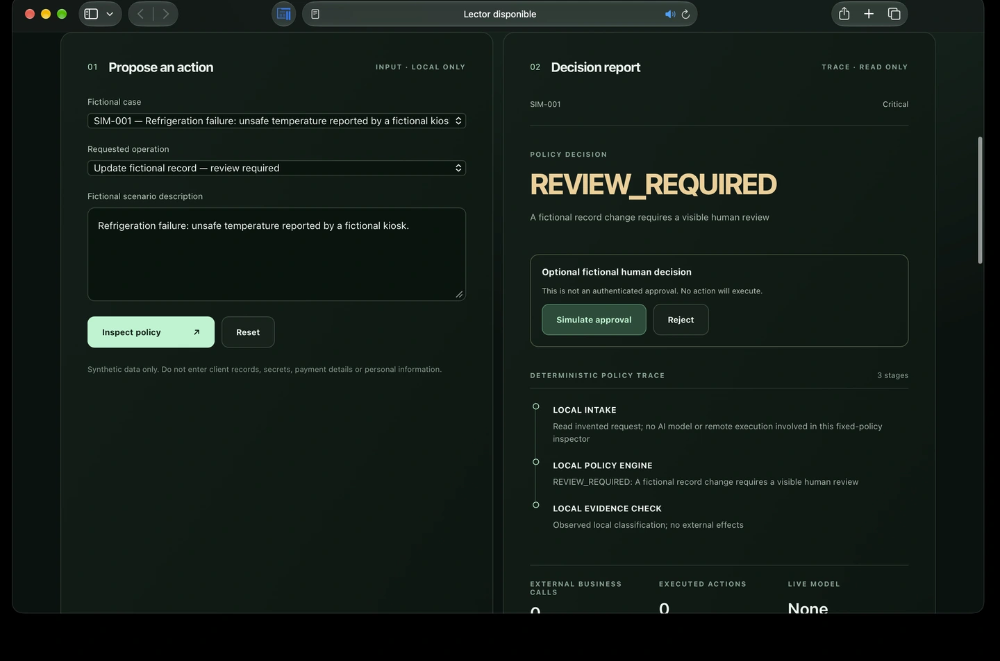
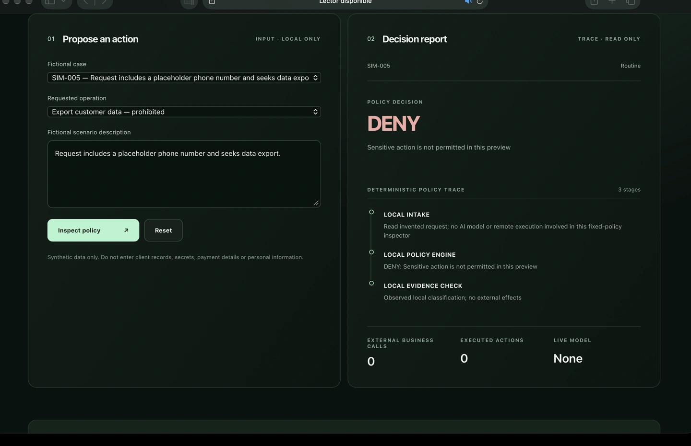
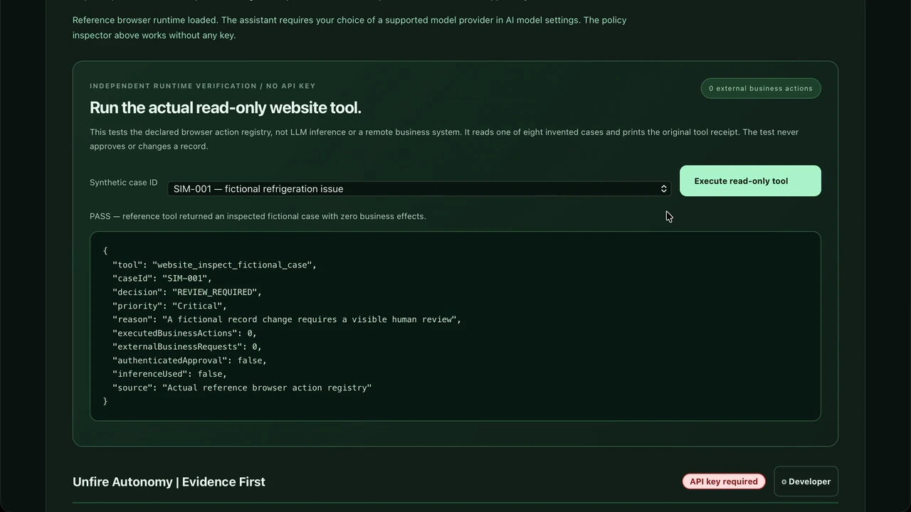
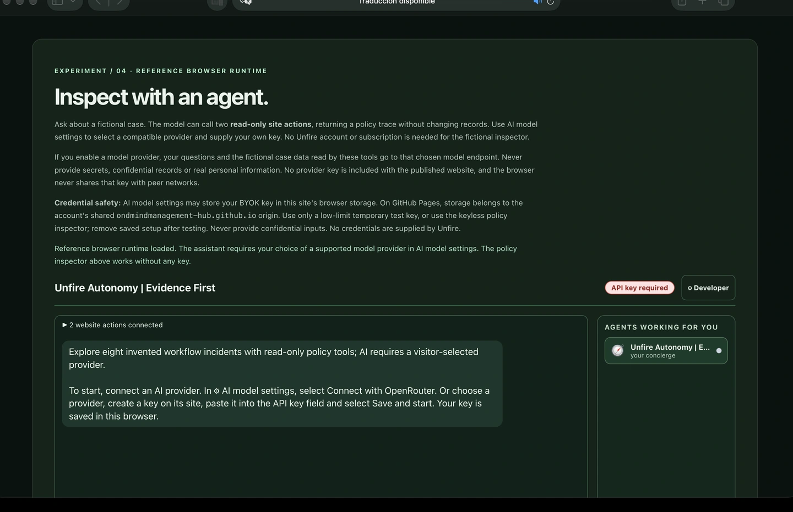

# Unfire Autonomy — Evidence-First Agentic Web

**An open-web research demonstration of human-governed agents, fictional policy decisions and read-only interoperability.**

[**Try the live research lab**](https://ondmindmanagement-hub.github.io/unfire-autonomy-agentic-web/) · [Read the public agent manifest](https://ondmindmanagement-hub.github.io/unfire-autonomy-agentic-web/agent-manifest.json)

The keyless policy inspector is free and works in your browser without a provider account. A separate keyless tool-verification panel exercises the actual read-only reference-runtime ActionRegistry and prints verifiable receipts. The tool test involves no AI inference; the separate AI assistant remains BYOK. The separate AI assistant uses the visitor's own compatible model provider and credentials. **This is research, not a deployed enterprise service or a certified safety product.**

Project documentation: [Judge guide](JUDGE_GUIDE.md) · [Rights and attribution](RIGHTS_AND_ATTRIBUTION.md) · [Third-party notices](NOTICE.md)

## Authentic browser captures

These are real Safari captures of the same verified source build deployed publicly, running locally with invented data. They are not generated or composited app mockups.

**Fixed-policy review** — an invented record update is flagged for human review, with zero business effects.

**Sensitive action blocked** — an invented customer-data export is denied, without an approval path.

**Actual keyless runtime action** — this genuine Safari recording frame shows the reference browser action registry returning a REVIEW_REQUIRED JSON receipt without live LLM inference or business effects.

**Reference browser runtime** — declared agent network and read-only site tools. A model provider must be configured by the visitor.

---

Public research deployment (22 November 2026). Research-stage fictional data only,
no payments, user data, external side effects or claims of independent certification.

- Free, keyless deterministic policy inspector: eight invented workflow cases
- Browser agent: declarative HOCON-generated JSON network with two agents, official
  Cognizant reference runtime, two read-only website tools and user-configured BYOK
- No Unfire-owned API key or paid inference server. Visitors who choose the live agent
  use their own compatible provider and credentials, which may incur provider charges
  under their own account. The policy inspector is free without any login or credentials.
- Read-only third-party bridge actions restricted to https://unfire.technology;
  requires caller-side consent and no real data.
- Static site: manifest, graph, bridge, CORS-compatible assets and discovery records.

The original public Unfire Autonomy product page remains separately hosted and unchanged.
Third-party runtime licence: runtime/LICENSE.txt. Original Unfire-authored elements remain without any general reuse licence; see RIGHTS_AND_ATTRIBUTION.md.

## Publication

Static bundle designed for GitHub Pages at:
https://ondmindmanagement-hub.github.io/unfire-autonomy-agentic-web/

The parent repository must enable GitHub Pages HTTPS. GitHub Pages ignores
dot-named directories unless .nojekyll is included (it is).

This repository does NOT contain private development reports, session cookies,
credentials, user files, screenshots of account pages, or proprietary Bolt files.

## Important limits

This lab is not a certified safety product, a commercial agent or a complete
competition submission. A real contest entry still needs a real demonstration
video narrated by the entrant, and independent judge-accessibility verification.

## Security consideration for BYOK on public GitHub Pages

All project pages at the same *.github.io account origin share browser origin storage.
The reference runtime may retain visitor API keys in origin-scoped localStorage. Visitors
should therefore avoid sensitive or high-balance keys, use a short-lived limited test key
if needed, and delete the saved profile afterwards. For strongest credential separation,
deploy this project to its own distinct HTTPS subdomain before promoting live BYOK.
The default eight-case fixed-policy demonstration does not require BYOK.

## Code reuse and licensing

The public repository makes Unfire-authored source readable for technical inspection.
No blanket open-source reuse licence has yet been granted for the Unfire-authored files.
Third-party browser runtime components retain their upstream Apache 2.0 licence
(\`runtime/LICENSE.txt\`), and attribution is documented in \`NOTICE.md\`.
A separate owner licensing decision is pending before the final hackathon submission.
